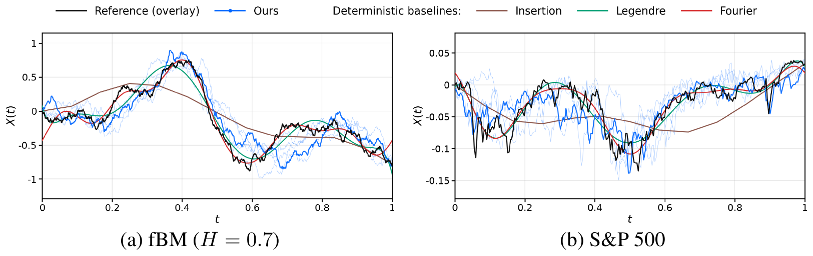

# Probabilistic Signature Inversion: Learning Conditional Distributions from Truncated Signatures

<p align="center">Official PyTorch implementation of our NeurIPS 2026 paper.</p>

<p align="center">
  <a href="https://arxiv.org/abs/2606.15332"></a>
  
  <a href="LICENSE"></a>
</p>

Junoh Kang<sup>1</sup> · Kiseop Lee<sup>2</sup> · Bohyung Han<sup>1,3</sup>

<sup>1</sup> ECE · <sup>3</sup> IPAI, Seoul National University · <sup>2</sup> Department of Statistics, Purdue University

## News

- **2026-10:** Code released.
- **2026-09:** Accepted to NeurIPS 2026.
- **2026-06:** Paper released on [arXiv](https://arxiv.org/abs/2606.15332).

## Overview

<p align="center">
  
</p>

<p align="center"><em>Probabilistic and deterministic signature inversion. Thin blue curves are five samples from probabilistic signature inversion, with one draw highlighted; deterministic baselines return one path each.</em></p>

The full signature determines a path up to tree-like equivalence, but only its truncation is computable, and the truncated signature map is many-to-one. Existing inversion methods still return a single representative path and leave this ambiguity unaddressed. We propose **Probabilistic Signature Inversion**, which models inversion generatively: a flow matching model conditioned on the log-signature learns the conditional distribution $P(X \mid S^{\le r}(X) = s)$.

We measure the ambiguity induced by probabilistic inversion with the **posterior-sampling reconstruction error**, the expected squared distance between a path and a sample from its signature-conditioned distribution:

$$
\mathcal{E}_r = \mathbb{E}_{X \sim P,\ \tilde{X} \sim P(\cdot \mid S^{\le r}(X))}\left[\int_0^T \left|X_t - \tilde{X}_t\right|^2 dt\right].
$$

Under linear-statistic (LS) conditioning, the posterior is numerically tractable for Gaussian processes, so the error can be obtained numerically; for log-GBM, it has a closed form. Empirical results match this oracle, and on both Gaussian processes and financial data, the learned model reproduces the distributional properties of each time series.

## 📦 Installation

```bash
# Python 3.10, CUDA 12.1
pip install torch==2.5.1 --extra-index-url https://download.pytorch.org/whl/cu121
pip install numpy==2.2.6
pip install -r requirements.txt
```

## Storage paths

```text
_data/<dataset>/{train,val,test/<split>}/
_checkpoints/<project>/<dataset>/<conditioning>/ckpt_epoch0100.pt
_outputs/<project>/<dataset>/test/<split>/
├── real.npz                   # Shared reference paths
├── <candidate>/
│   ├── paths.npz              # Inverted paths
│   ├── inversion.json         # Input and sampling settings
│   └── quant.json             # Latest quantitative metrics
└── results/
    ├── quant/
    │   ├── summary.csv         # All saved candidate evaluations
    │   └── oracle.json        # Separate LS oracle result
    └── qual/                  # Qualitative plots
```

- `--output-root`: change the storage root.
- `--project`: specify the group for checkpoints and inversion outputs.

Re-evaluation replaces the selected candidates' `quant.json` and refreshes `summary.csv`; oracle results are stored separately.

## Data

**Gaussian processes.**

```bash
python -m probsiginv.cli.build_dataset configs/dataset/gbm_default.yaml   # log-GBM
python -m probsiginv.cli.build_dataset configs/dataset/fbm_default.yaml   # drifted fBM
python -m probsiginv.cli.build_dataset configs/dataset/ou_default.yaml    # OU
python -m probsiginv.cli.build_dataset configs/dataset/gbm_d2.yaml        # 2D log-GBM
```

**Financial data.** S&P 500 prices are downloaded automatically with `yfinance`. For FX, download `exchange_rates.npy` from [SigDiffusions](https://drive.google.com/drive/folders/1VczlFKk5ckU5YNqNi9q9wbJBnKMuxiu6) and save it as `_data/exchange_rates.npy`.

```bash
python -m probsiginv.cli.build_dataset configs/dataset/sp500_daily.yaml  # S&P 500
python -m probsiginv.cli.build_dataset configs/dataset/fx_daily.yaml     # Foreign exchange
```

**TLL3 coordinate reduction.** The selection that removes redundant conditioning coordinates is provided in `configs/signature/TLL3_logsig.yaml`. Regenerate it only if needed:

```bash
python -m probsiginv.cli.generate_signature_config \
    --data _data/gbm_mu1.5-2.5_sig1.5-2.5 --aug-type TLL3
```

## Training

```bash
# Flow matching
python -m probsiginv.cli.train configs/train/flow_dit.yaml \
    --data-path _data/gbm_mu1.5-2.5_sig1.5-2.5 \
    --aug-type TLL3 --sig-depth 6 --sig-transform level_symlog --epochs 100

# Regression
python -m probsiginv.cli.train configs/train/reg_dit.yaml \
    --data-path _data/gbm_mu1.5-2.5_sig1.5-2.5 \
    --aug-type TLL3 --sig-depth 6 --sig-transform level_symlog --epochs 100
```

## Inversion

```bash
DATA=_data/gbm_mu1.5-2.5_sig1.5-2.5/test/gbm_mu1.5-2.5_sig1.5-2.5
PROJECT=flow_dit_level_symlog

# Flow matching
python -m probsiginv.cli.invert --dataset $DATA --project $PROJECT \
    --ckpt _checkpoints/flow_dit_level_symlog/gbm_mu1.5-2.5_sig1.5-2.5/TLL3d6/ckpt_epoch0100.pt \
    --n-repeats 30 --sampling-steps 1000 --seed 7

# Regression
python -m probsiginv.cli.invert --dataset $DATA --project $PROJECT --method regression \
    --ckpt _checkpoints/reg_dit_level_symlog/gbm_mu1.5-2.5_sig1.5-2.5/reg_TLL3d6/ckpt_epoch0100.pt

# Deterministic baselines
python -m probsiginv.cli.invert --dataset $DATA --project $PROJECT --method fourier   --fourier-sig-depth 8   --n-coeffs 6
python -m probsiginv.cli.invert --dataset $DATA --project $PROJECT --method legendre  --legendre-sig-depth 12 --n-coeffs 10
python -m probsiginv.cli.invert --dataset $DATA --project $PROJECT --method insertion --insertion-sig-depth 12

# LS posterior
python -m probsiginv.cli.invert --dataset $DATA --project $PROJECT --method ls_posterior --sig-depth 6 \
    --mu-bounds 1.5 2.5 --sigma-bounds 1.5 2.5 --n-repeats 30 --seed 7
```

## Evaluation

```bash
INVERSION_DIR=_outputs/flow_dit_level_symlog/gbm_mu1.5-2.5_sig1.5-2.5/test/gbm_mu1.5-2.5_sig1.5-2.5

# LS oracle
python -m probsiginv.cli.eval_quantitative $INVERSION_DIR --metrics oracle \
    --mu-bounds 1.5 2.5 --sigma-bounds 1.5 2.5

# Quantitative metrics
python -m probsiginv.cli.eval_quantitative $INVERSION_DIR
python -m probsiginv.cli.eval_quantitative $INVERSION_DIR --candidate LSd6 \
    --metrics energy-distance \
    --energy-reference $INVERSION_DIR/ls_posterior_LSd6/paths.npz

# Qualitative plots
python -m probsiginv.cli.eval_qualitative $INVERSION_DIR
```

## Citation

If you find this work useful, please cite:

```bibtex
@inproceedings{kang2026probabilistic,
  title         = {Probabilistic Signature Inversion: Learning Conditional Distributions from Truncated Signatures},
  author        = {Kang, Junoh and Lee, Kiseop and Han, Bohyung},
  booktitle     = {Advances in Neural Information Processing Systems},
  year          = {2026},
}
```

## Acknowledgements

We use [iisignature](https://github.com/bottler/iisignature) and baseline code from [SigDiffusions](https://github.com/Barb0ra/SigDiffusions) (Barancikova et al.), [Signatory](https://github.com/patrick-kidger/signatory) (Kidger and Lyons), and [free-lie-algebra-py](https://github.com/bottler/free-lie-algebra-py) (Jeremy Reizenstein). See [LICENSE](LICENSE) for third-party terms.

## License

MIT, except for the third-party code noted above. See [LICENSE](LICENSE) for the terms of each file.
